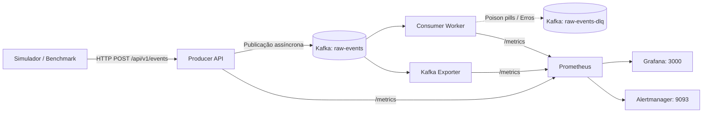

# Arquitetura do Sistema

## Componentes e Responsabilidades
- **Producer API:** Ingestão HTTP de eventos via `POST /api/v1/events` e `POST /events`. Validação Pydantic (UUID, timezone, schema), enfileiramento assíncrono no Kafka, rejeição antecipada de payloads > 64 KiB (413), headers de segurança e métricas RED.
- **Apache Kafka (KRaft):** Broker de mensageria em modo KRaft com 3 partições no tópico `raw-events` e 3 partições no tópico `raw-events-dlq`. Retenção de 1 GB por partição.
- **Consumer Worker:** Consumo assíncrono via Consumer Group `events-processor`, simulação de latência de processamento, injeção de falhas determinísticas (`PROCESSING_ERROR_RATE`), envio de poison pills para a DLQ e cálculo dinâmico de lag.
- **Kafka Exporter:** Exportador nativo do cluster para coleta de partições, offsets e lag do consumer group.
- **Prometheus:** Coleta em intervalo de 5s, descoberta dinâmica de réplicas de consumer via `dns_sd_configs` e avaliação de alertas (`HighConsumerLag` e `HighErrorRate`).
- **Grafana:** Visualização automática via dashboards provisionados (`pipeline.json`), renderizando taxas de ingestão, percentis p50/p95/p99, proporção de erros e lag por partição.
- **Alertmanager:** Recepção, deduplicação e roteamento de alertas de degradação e erro.

## Segmentação de Rede (Zero Trust)
- **`messaging-network`:** Comunicação exclusiva de dados entre `kafka`, `kafka-init`, `producer`, `consumer` e `kafka-exporter`.
- **`observability-network`:** Comunicação de telemetria entre `producer`, `consumer`, `kafka-exporter`, `prometheus`, `grafana` e `alertmanager`.
- O Broker e Controller do Kafka não são acessíveis a partir do Grafana ou Alertmanager.
