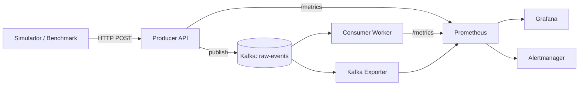

# Arquitetura

## Responsabilidades
- **Producer:** valida entrada, publica assincronamente, mede HTTP e resultado de publicação.
- **Kafka:** buffer de eventos particionados.
- **Consumer:** consome por grupo, simula processamento, mede duração e resultado.
- **Kafka Exporter:** expõe métricas de cluster, partições e consumer group lag.
- **Prometheus:** coleta métricas em 2–5 s e avalia regras.
- **Grafana:** dashboards provisionados em arquivos.
- **Alertmanager:** recebe alertas do Prometheus.

## Limites
`/metrics` não deve exportar payload, identificadores de evento ou labels de alta cardinalidade. Logs e eventos brutos não vão para o Prometheus.

## Decisões ainda pendentes
Versão e modo de execução do Kafka, número de partições, semântica de entrega, estratégia de commit de offsets e definição exata da medição de lag. Ver `11-open-decisions.md`.
